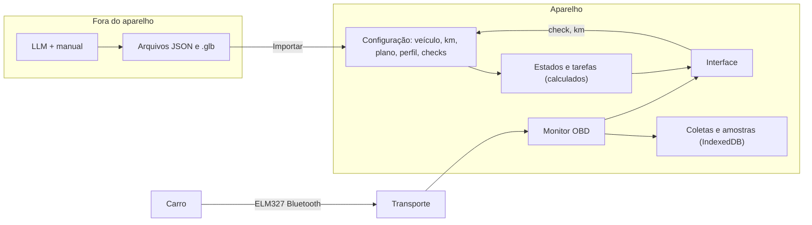

# Arquitetura

O produto é um APK para Android ([ADR 0005](adr/0005-produto-e-o-apk.md)), que funciona só no aparelho ([ADR 0006](adr/0006-sem-rede.md)). A interface é uma página web sem etapa de build, em JavaScript puro, carregada dentro do APK. Enquanto ele não existe, ela roda no navegador, apenas para desenvolver. A lógica fica em módulos sem DOM, testados no Node.

## Módulos

| Caminho | Responsabilidade | DOM? |
|---|---|---|
| `app/app.js` | Ponto de partida: liga telas e conexão | Sim |
| `app/estado.js` | Configuração salva, preferências e o que se calcula delas | Armazenamento |
| `app/banco.js` | IndexedDB: modelo 3D, coletas e amostras | Armazenamento |
| `app/dominio/config.js` | Formato da configuração e migração | Não |
| `app/dominio/manutencao.js` | Plano, checks, estados e tarefas | Não |
| `app/dominio/leituras.js` | Leituras: pares de data e km, com as regras de ordem | Não |
| `app/telas/` | Uma por tela, mais navegação, folha de check, gráfico e as views de Tarefas | Sim, fora `views_tarefas.js` e `grafico.js` |
| `app/cena/` | Cena 3D, carro genérico, câmera e recusa de `.glb` com conteúdo externo | Sim |
| `app/obd/protocolo.js` | Parser das respostas e lista de comandos permitidos | Não |
| `app/obd/sinais.js` | Catálogo de sinais | Não |
| `app/obd/monitor.js` | Agenda de leituras do carro e máquina de estados | Não |
| `app/obd/conexao.js` | Monitor, gravação e últimos valores | Não |
| `app/obd/transportes.js` | Android e simulador | Não |
| `app/obd/coletas.js` | Gravação e CSV | Armazenamento |
| `app/obd/historico.js` | Resumo de cada sinal por coleta e os pontos de uma coleta | Não |
| `android/` | Casca nativa: WebView só com os arquivos do APK, Bluetooth, importar e exportar | Não |
| `ferramentas/` | Validadores, guardas e geração do APK | Não |
| `dev/` | Servidor local, só do mantenedor e fora do Git | Não |

## Manutenção

Cinco objetos, separados de propósito ([ADR 0004](adr/0004-tarefas-calculadas.md)):

| Objeto | Conteúdo | Quem altera |
|---|---|---|
| **Plano** | O que o documento manda fazer | Importado |
| **Perfil** | Uso e opções deste carro | Pessoa, em Configurações |
| **Leituras** | Pares de data e km do carro | Pessoa, no início, em um check ou em Configurações |
| **Checks** | O que foi feito ou verificado, ligado a uma Leitura | Pessoa, na tela Manutenção |
| **Tarefas** | O que fazer agora | Ninguém: `estadoServico` e `listarTarefas` calculam |

A aba Tarefas tem quatro views dos mesmos dados, cada uma organizada por uma entidade: Trilha (Serviço), Visitas (Leitura), Grade (Check) e Peças (Componente). Na Trilha e na Grade, cada Sistema é uma lane que abre nos seus Componentes e Serviços, e uma legenda explica os desenhos. As datas futuras são estimadas pelo ritmo das Leituras e só aparecem com um intervalo de ao menos uma semana entre elas.

Detalhes em [Plano de manutenção](plano-de-manutencao.md) e no [ADR 0007](adr/0007-leitura-como-entidade.md).

## Dados do carro

Separados das Leituras de data e km, com nomes próprios:

| Objeto | Conteúdo |
|---|---|
| **Coleta** | Uma conexão, do início ao fim. Fica na loja `sessoes`, com o resumo de cada sinal |
| **Amostra** | Um valor lido do carro, com data e hora. Fica na loja `amostras` |
| **Regime** | Calculado: motor parado, motor ligado com o carro parado ou andando |

A tela Dados OBD tem três vistas: Sinais, Histórico e Coletas. Sinais mostra a coleta em andamento ou uma passada, com um gráfico por sinal e escala ajustada aos dados. O histórico guarda média, mínimo e máximo por coleta. O regime continua gravado, e o filtro padrão fica no motor ligado, porque com o motor parado vários sinais são valores padrão da ECU. Ele não usa faixas genéricas de "normal": compara o carro com ele mesmo. O simulador não entra no histórico quando há coleta real.

## Conexão com o carro

Todo transporte implementa `listar()`, `abrir(endereco)`, `comando(texto, timeoutMs)` e `fechar()`. O Android expõe `window.ObdNativo.pedir(id, metodo, argsJson)` e responde depois por `window.obdNativoResposta(id, ok, valor)`, para uma pergunta ao carro não travar a tela. Também expõe `salvar(nome, tipo, texto)`, em que a pessoa escolhe onde o arquivo fica.

O app lista só adaptadores já pareados no Android e não pede permissão de busca. A WebView responde sozinha a cada arquivo a partir dos assets do APK e recusa qualquer outro endereço.

Estados do adaptador: desconectado, conectando, conectado e reconectando. Estados do veículo: desconhecido, desligado, chave ligada e motor ligado.

## Dados no aparelho

| Dado | Onde |
|---|---|
| Configuração, km, plano, perfil e checks | `localStorage` |
| Modelo 3D, coletas e amostras | IndexedDB |
| Adaptador escolhido e preferências de tela | `localStorage`, fora do arquivo exportado |

Em **Configurações → Dados**, a pessoa exporta o histórico (Leituras e checks, que voltam por **Importar arquivo**), as coletas em CSV ou a configuração inteira, e pode zerar o histórico ou apagar tudo. Na importação, km e checks são mesclados, e o que já está no aparelho prevalece. Os arquivos exportados terminam em `.config.local.json` ou `.csv`, ignorados pelo Git.

## O que ainda não existe

- Coleta com a tela apagada, que no Android exige serviço em primeiro plano.
- Leitura de códigos de falha pelos modos 03 e 07.
- Limite automático de espaço das coletas.
